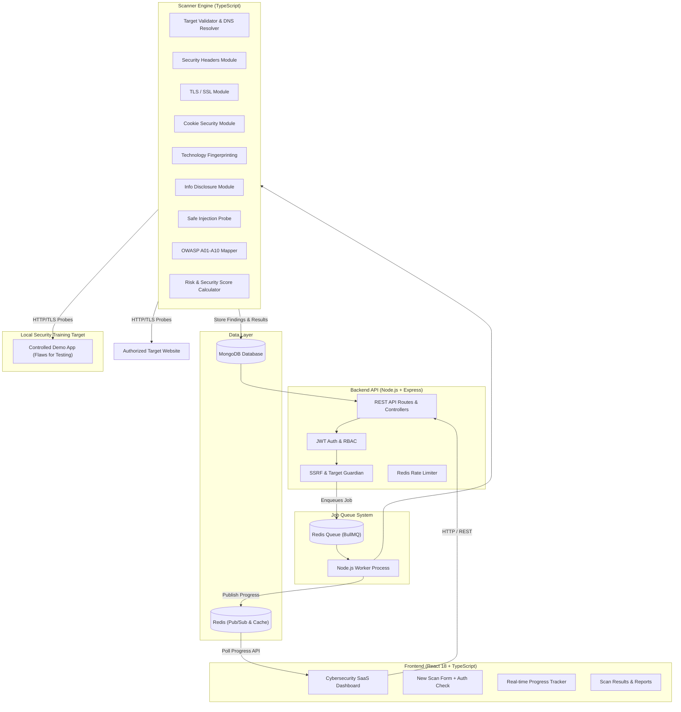

# WebSentinel — Automated Web Security Assessment Platform

**WebSentinel** is an automated, defensive web application security assessment platform built specifically for small organizations. It automates vulnerability scanning, detects security misconfigurations, analyzes OWASP Top 10 compliance, evaluates TLS/SSL & HTTP security headers, and generates actionable, evidence-backed security reports with code remediation guidance.

---

## Architecture Diagram



---

## Problem Statement & Solution

Small organizations frequently deploy web applications without conducting regular security assessments. Commercial penetration testing is expensive, while complex open-source vulnerability scanners require specialized cybersecurity knowledge to operate and interpret.

**WebShield** solves this by providing:
1. **Automated Non-Destructive Scanning:** Safe, controlled probes covering transport security, headers, cookies, tech stack, and disclosures.
2. **OWASP Top 10 Mapping:** Clear alignment of discovered issues to OWASP categories (A01–A10).
3. **Evidence-Backed Findings:** Every reported vulnerability includes exact response header evidence, affected URLs, and step-by-step code remediation instructions.
4. **Before/After Scan Comparison:** Enables teams to verify remediation progress and track score improvements over time.

---

## Technology Stack

- **Frontend:** React 18, TypeScript, Vite, Vanilla CSS Design System, Lucide Icons
- **Backend:** Node.js, Express.js, TypeScript, Zod Schema Validation, Helmet Security
- **Database:** MongoDB 7.0 (Document collections, UUID indexing, aggregation pipelines)
- **Job Queue & Caching:** Redis 7, BullMQ, ioredis
- **Containerization:** Docker, Docker Compose
- **Report Engine:** PDFKit (PDF Security Report Generation)

---

## Installation & Setup

### Prerequisites
- [Docker](https://www.docker.com/) and Docker Compose installed.

### Quickstart with Docker Compose

1. Clone repository and initialize environment configuration:
   ```bash
   cp .env.example .env
   ```

2. Build and launch all 5 microservices:
   ```bash
   docker compose up --build
   ```

3. Access application services:
   - **Frontend Dashboard:** [http://localhost:3000](http://localhost:3000)
   - **Backend REST API:** [http://localhost:5000](http://localhost:5000)
   - **Local Security Training Target:** [http://localhost:8080](http://localhost:8080)

### Seed Accounts (Created Automatically)
- **Admin Account:** `admin@webshield.io` / `Admin@123456`
- **User Account:** `user@webshield.io` / `User@123456`

---

## Demonstrating Remediation Workflow

1. Log in with `user@webshield.io` / `User@123456`.
2. Go to **New Scan** and enter `http://localhost:8080` (Local Security Training Target).
3. Confirm authorization declaration and click **START SECURITY SCAN**.
4. Watch real-time scan progress steps.
5. Review results: Initial Security Score ~**48/100** with findings (Missing CSP, HSTS, insecure cookies, exposed `.env.example`).
6. Open `http://localhost:8080`, click **Switch to REMEDIATED Mode** on the training target.
7. Perform a new scan on `http://localhost:8080`.
8. Go to **Compare Scans** to verify the score jump to **90+/100** and zero critical/high findings!

---

## SSRF Protection & Responsible Use Policy

WebShield enforces multi-layered Server-Side Request Forgery (SSRF) protection:
- Restricts target protocol schemes strictly to `http:` and `https:`.
- Resolves DNS hostnames to IPv4/IPv6 addresses and validates resolved IPs against blocklists (`127.0.0.0/8`, `10.0.0.0/8`, `172.16.0.0/12`, `192.168.0.0/16`, `169.254.0.0/16`, `::1`).
- Requires explicit user authorization confirmation before queueing scans.

---

## Security Disclaimer & Product Limitations

WebShield provides automated first-level security assessment. Automated scanning cannot identify every vulnerability, particularly complex business-logic, authorization, and authenticated vulnerabilities. Manual penetration testing is recommended for production systems.
