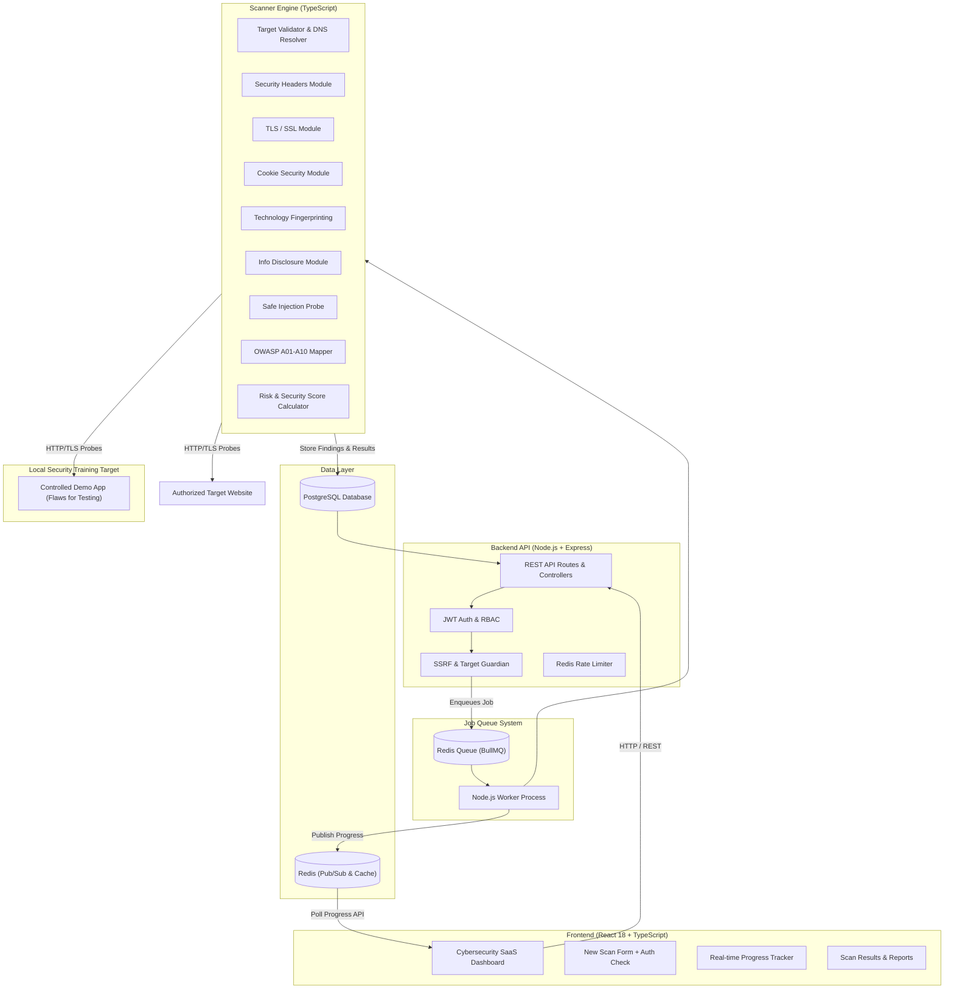

# WebShield — Architecture & Implementation Blueprint

## Executive Overview
**WebShield** is a defensive cybersecurity and vulnerability assessment platform built specifically for small organizations. It automates security scanning, detects security misconfigurations, analyzes OWASP Top 10 compliance, evaluates TLS & HTTP security headers, and generates actionable, evidence-backed security reports with remediation guidance.

---

## Architecture Diagram



---

## 1. Directory Structure

```
webshield/
├── backend/
│   ├── src/
│   │   ├── controllers/         # Auth, Scan, Report, Dashboard, Admin controllers
│   │   ├── routes/              # Express REST API routes
│   │   ├── middleware/          # Auth JWT, Rate Limit, Validation, Error Handler
│   │   ├── services/            # Database, PDF report generator, Redis queue services
│   │   ├── database/            # PostgreSQL client, migrations, seeds
│   │   ├── scanner/
│   │   │   ├── core/            # TargetValidator, RequestManager, RateLimiter, ScanContext
│   │   │   ├── modules/         # Headers, TLS, Cookie, Tech, Disclosure, Injection, AccessControl
│   │   │   ├── owasp/           # A01 to A10 mapping engines
│   │   │   ├── scoring/         # RiskCalculator, SeverityCalculator
│   │   │   └── reporting/       # Executive summary & detail report generator
│   │   ├── security/            # SSRF protection, IP validation, Sanitization
│   │   └── index.ts             # Server entry point
│   ├── tests/                   # Unit & Integration tests (Jest/Supertest)
│   ├── package.json
│   ├── tsconfig.json
│   └── Dockerfile
├── frontend/
│   ├── src/
│   │   ├── components/          # Gauge, Charts, FindingCard, OWASPBadge, Navbar, Modal
│   │   ├── pages/               # Landing, Dashboard, NewScan, ScanProgress, ScanResults, History, Compare, Admin
│   │   ├── layouts/             # AppLayout, AuthLayout, PublicLayout
│   │   ├── services/            # API client (Axios/Fetch), Auth service, Scan service
│   │   ├── hooks/               # useAuth, useScanProgress, useDashboard
│   │   ├── types/               # TypeScript interfaces (Scan, Finding, OWASP, User)
│   │   └── index.css            # Custom CSS Tokens & Cyber Dark Glassmorphism Styling
│   ├── package.json
│   ├── vite.config.ts
│   └── Dockerfile
├── demo-target/                 # Local Security Training Target container
│   ├── src/                     # Intentionally configurable web server with test vulnerabilities
│   ├── package.json
│   └── Dockerfile
├── docs/                        # Architecture, API, Security Model, Methodology docs
├── docker-compose.yml           # Postgres, Redis, Backend, Frontend, Demo-Target
├── .env.example
├── .gitignore
└── README.md
```

---

## 2. Core Security & SSRF Guardian Design

To ensure **WebShield** remains safe and defensive:
1. **Target Authorization:** Mandatory user declaration `[x] I confirm that I am authorized to scan this target` verified on both client and backend API payload.
2. **SSRF Guardian Filter (`TargetValidator.ts`):**
   - Parse protocol: restrict strictly to `http:` and `https:`.
   - Resolve hostname via DNS to target IPv4 / IPv6 addresses.
   - Block reserved & private network ranges:
     - `127.0.0.0/8` (Loopback)
     - `10.0.0.0/8`, `172.16.0.0/12`, `192.168.0.0/16` (Private IPv4)
     - `169.254.0.0/16` (Link-local / Cloud Metadata `169.254.169.254`)
     - `::1/128`, `fc00::/7`, `fe80::/10` (IPv6 Private/Link-local)
     - Explicit localhost/internal domains unless targeting the specified `DEMO_TARGET_HOST` environment variable explicitly permitted for demo environments.
   - Prevent DNS Rebinding: Re-verify resolved IP before dispatching HTTP socket connections.

---

## 3. Security Scanner & OWASP Engine Modules

| Module Name | Checks & Analysis Conducted | Safety Profile |
| :--- | :--- | :--- |
| **`HeadersScanner`** | Detects missing/misconfigured `CSP`, `HSTS`, `X-Frame-Options`, `X-Content-Type-Options`, `Referrer-Policy`, `Permissions-Policy`. Inspects `Server` & `X-Powered-By` information disclosure. | Passive HTTP GET |
| **`TLSScanner`** | Validates HTTPS availability, HTTP->HTTPS redirect, TLS certificate validity, expiration date, issuer, hostname matching, mixed content indicators. | TLS Socket inspection |
| **`CookieScanner`** | Parses Set-Cookie headers for `HttpOnly`, `Secure`, and `SameSite` flags. Flags insecure session storage. | Passive HTTP Response |
| **`TechnologyScanner`** | Identifies tech stack (React, Express, Nginx, Apache, WordPress, PHP, jQuery, etc.) via header signatures, meta tags, script URLs, known generator tags. | Passive HTML/JS analysis |
| **`InformationDisclosureScanner`** | Probes for exposed `.env.example`, `robots.txt` leaks, exposed `.git/config` paths, stack trace exposures, directory listing status. | Safe HTTP HEAD/GET |
| **`InjectionScanner`** | Tests for reflected query parameter echo, HTML escaping failure indicators, SQL syntax error disclosures. | Non-destructive test strings |
| **`AccessControlScanner`** | Probes common administrative route endpoints (`/admin`, `/config.json`, `/backup.sql`) for open access or directory listing. | Safe HTTP GET probes |
| **`OWASPEngine`** | Maps findings to A01 (Access Control) through A10 (SSRF) categories. Assigns standard status: `PASS`, `FAIL`, `WARNING`, `NOT_TESTED`, `MANUAL_REVIEW_REQUIRED`. | Logic aggregator |
| **`RiskCalculator`** | Computes Security Score starting from 100 with weighted deductions (Critical: -25, High: -15, Medium: -8, Low: -3, Info: -1) and confidence multipliers. | Mathematical Engine |

---

## 4. PostgreSQL Database Schema

```sql
-- Users Table
CREATE TABLE users (
    id UUID PRIMARY KEY DEFAULT gen_random_uuid(),
    name VARCHAR(255) NOT NULL,
    email VARCHAR(255) UNIQUE NOT NULL,
    password_hash VARCHAR(255) NOT NULL,
    role VARCHAR(50) DEFAULT 'USER', -- 'USER', 'SECURITY_ANALYST', 'ADMIN'
    created_at TIMESTAMP WITH TIME ZONE DEFAULT CURRENT_TIMESTAMP,
    updated_at TIMESTAMP WITH TIME ZONE DEFAULT CURRENT_TIMESTAMP
);

-- Scans Table
CREATE TABLE scans (
    id UUID PRIMARY KEY DEFAULT gen_random_uuid(),
    user_id UUID REFERENCES users(id) ON DELETE CASCADE,
    target_url VARCHAR(2048) NOT NULL,
    status VARCHAR(50) NOT NULL, -- 'PENDING', 'RUNNING', 'COMPLETED', 'FAILED', 'CANCELLED'
    scan_type VARCHAR(50) DEFAULT 'STANDARD', -- 'QUICK', 'STANDARD', 'DEEP'
    security_score INT DEFAULT 100,
    started_at TIMESTAMP WITH TIME ZONE,
    completed_at TIMESTAMP WITH TIME ZONE,
    created_at TIMESTAMP WITH TIME ZONE DEFAULT CURRENT_TIMESTAMP
);

-- Findings Table
CREATE TABLE findings (
    id UUID PRIMARY KEY DEFAULT gen_random_uuid(),
    scan_id UUID REFERENCES scans(id) ON DELETE CASCADE,
    title VARCHAR(255) NOT NULL,
    description TEXT NOT NULL,
    severity VARCHAR(50) NOT NULL, -- 'CRITICAL', 'HIGH', 'MEDIUM', 'LOW', 'INFORMATIONAL'
    confidence VARCHAR(50) NOT NULL, -- 'HIGH', 'MEDIUM', 'LOW', 'UNKNOWN'
    status VARCHAR(50) DEFAULT 'CONFIRMED',
    owasp_category VARCHAR(10) NOT NULL, -- e.g. 'A05'
    cwe VARCHAR(50),
    affected_url VARCHAR(2048) NOT NULL,
    evidence TEXT NOT NULL,
    impact TEXT NOT NULL,
    remediation TEXT NOT NULL,
    created_at TIMESTAMP WITH TIME ZONE DEFAULT CURRENT_TIMESTAMP
);

-- Technologies Table
CREATE TABLE technologies (
    id UUID PRIMARY KEY DEFAULT gen_random_uuid(),
    scan_id UUID REFERENCES scans(id) ON DELETE CASCADE,
    name VARCHAR(100) NOT NULL,
    version VARCHAR(50),
    category VARCHAR(100),
    confidence VARCHAR(50) DEFAULT 'HIGH'
);

-- OWASP Results Table
CREATE TABLE owasp_results (
    id UUID PRIMARY KEY DEFAULT gen_random_uuid(),
    scan_id UUID REFERENCES scans(id) ON DELETE CASCADE,
    category VARCHAR(10) NOT NULL, -- 'A01' .. 'A10'
    status VARCHAR(50) NOT NULL, -- 'PASS', 'FAIL', 'WARNING', 'NOT_TESTED', 'MANUAL_REVIEW_REQUIRED'
    score INT DEFAULT 100,
    findings_count INT DEFAULT 0
);

-- Reports Table
CREATE TABLE reports (
    id UUID PRIMARY KEY DEFAULT gen_random_uuid(),
    scan_id UUID REFERENCES scans(id) ON DELETE CASCADE,
    file_path VARCHAR(1024) NOT NULL,
    created_at TIMESTAMP WITH TIME ZONE DEFAULT CURRENT_TIMESTAMP
);

-- Audit Logs Table
CREATE TABLE audit_logs (
    id UUID PRIMARY KEY DEFAULT gen_random_uuid(),
    user_id UUID REFERENCES users(id) ON DELETE SET NULL,
    action VARCHAR(255) NOT NULL,
    metadata JSONB,
    created_at TIMESTAMP WITH TIME ZONE DEFAULT CURRENT_TIMESTAMP
);
```

---

## 5. Development Roadmap & Phased Execution

| Phase | Scope & Key Deliverables |
| :--- | :--- |
| **Phase 1** | Project Setup, Directory Structure, Environment Configuration & Docker Setup |
| **Phase 2** | Database Migrations, Authentication, JWT Security & REST API |
| **Phase 3** | Target Validation, SSRF Protection & Redis Scan Queue |
| **Phase 4** | Node.js Security Scanner Core & OWASP Rule Modules |
| **Phase 5** | Risk Scoring Engine & Detailed Finding Generator |
| **Phase 6** | Local Security Training Target (`demo-target`) Container |
| **Phase 7** | Frontend React Cyber SaaS App & Security Dashboard |
| **Phase 8** | Report Generation, Automated Testing & Documentation |
